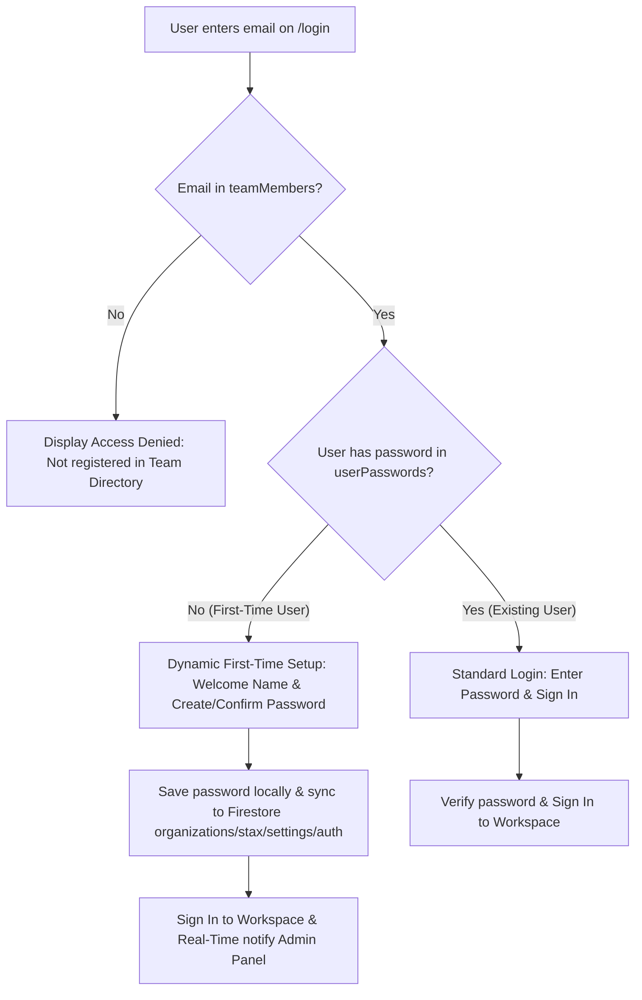
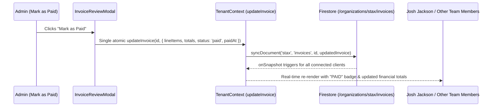

# StaxHQ Auth Whitelist, First-Time Setup & Real-Time Sync Design

**Date:** 2026-10-16  
**Status:** Approved  

## 1. Overview & Goals

1. **Remove 1-Click Fast Login Drawer**: Remove the "Authorized Team Members & 1-Click Entry" accordion and demo auto-login buttons from the login page, and clear hardcoded email prefills.
2. **Strict Directory Whitelist Gate**: Enforce that ONLY email addresses present in the `teamMembers` directory can access the platform. If an email is not recognized, immediate access denial is enforced with no password setup or sign-in permitted.
3. **Dynamic First-Time Password Setup**:
   - For authorized team members with no password set yet (e.g. newly added members like Josh Jackson `jjackson@staxifytech.com` or Staxify Team `staxify2025@gmail.com`), the login interface dynamically detects their first-time status.
   - It displays a personalized greeting ("Welcome [Name]!") and transitions the form into a secure password establishment interface ("Create Password" and "Confirm Password" with validation and visibility toggles).
   - Once submitted, the password is encrypted/saved and synchronized immediately to Firestore Cloud (`organizations/stax/settings/auth`) and active context so that the Admin panel immediately updates the member's status from "Setup on 1st Login" to "Reset Pass" in real-time.
4. **System-Wide Real-Time Synchronization for HQ Changes (Invoices Paid, CRM Updates)**:
   - Fix race conditions in `InvoiceReviewModal.tsx` where dual concurrent `updateInvoice` calls caused paid status to conflict or revert.
   - Consolidate status updates and line-item changes into a single atomic write to Firestore.
   - Guarantee that when any team member marks an invoice as Paid, the change propagates system-wide via real-time Firestore `onSnapshot` listeners to all other team members and updates customer revenue metrics.

---

## 2. Architecture & Data Flow

### 2.1 Login Flow & Directory Whitelist


### 2.2 System-Wide Invoice Status Synchronization


---

## 3. Detailed Component & Service Changes

### 3.1 `src/app/login/page.tsx`
- **Remove**:
  - Entire `<div className="rounded-xl border border-slate-800/80 bg-slate-900/50 ...">` 1-Click Entry drawer (lines 605-696).
  - `handleQuickLogin` helper and `showQuickAccess` state.
  - Default email state initialization: change `useState("jeff@staxifytech.com")` to empty string `useState("")`.
- **Dynamic Detection Logic**:
  - Add `matchedMember` and `isFirstTimeSetup` computed states based on entered email:
    - Normalizes entered email and matches against `teamMembers`.
    - Checks `userPasswords[matched.email.toLowerCase()]`.
    - If `matchedMember` exists and has no password, flag as `isFirstTimeSetup = true`.
- **UI Adaptation**:
  - If `isFirstTimeSetup`:
    - Shows welcome badge: `✨ Welcome [matchedMember.displayName]! Please establish your password to activate your account.`
    - Fields: "Create Password" & "Confirm Password" (with eye toggle icons, min 6 characters).
    - Button: "Create Password & Access Workspace ➔".
  - If email entered is invalid / not in directory:
    - Display error: `"Access Denied: '${email}' is not registered in the StaxHQ Team Directory. Contact your workspace administrator for access."`
  - If email is valid with existing password:
    - Fields: "Password" (with eye toggle) + "Forgot Password?" link.
    - Button: "Sign In to Workspace ➔".

### 3.2 `src/lib/firebase/tenantContext.tsx`
- **First-Time Password Establishment**:
  - Inside `login(email, password)`:
    - When `!currentSavedPassword`:
      - Validate minimum 6 characters.
      - Save to `userPasswords` state and `localStorage`.
      - **CRITICAL**: Call `syncAuthCredentials(activeOrg.id, updatedPasswords)` so Firestore receives the new password immediately.
      - Set active authenticated session.
- **Whitelist Enforcement**:
  - Ensure strict matching against `teamMembers` only. Remove legacy auto-creation of mock users upon arbitrary login.
- **Admin Password Reset**:
  - When `resetTeamMemberPassword(email, newPass)` is called from the Admin page:
    - Syncs to Firestore immediately so if admin clears a password or sets a temporary one, all devices reflect it.

### 3.3 `src/components/financials/InvoiceReviewModal.tsx`
- **Atomic Invoice Update**:
  - Refactor `handleMarkAsPaid`:
    ```ts
    const handleMarkAsPaid = () => {
      const updatedDue = dueDateStr ? new Date(dueDateStr).getTime() : invoice.dueDate;
      updateInvoice(invoice.id, {
        dueDate: updatedDue,
        lineItems,
        subtotal: roundedSubtotal,
        total,
        notes,
        status: "paid",
        paidAt: Date.now(),
      });
      onClose();
    };
    ```
  - Refactor `handleSendGmail` similarly to perform a single atomic write with `status: "sent"`, `sentAt: Date.now()`.
  - Guarantees zero race conditions in Firestore and instantaneous synchronization to all connected team members.

---

## 4. Error Handling & Edge Cases
- **Case Insensitivity**: Emails are normalized with `.trim().toLowerCase()`.
- **Offline / Cloud Fallback**: If Firestore is briefly unreachable, local storage preserves the session and syncs credentials once online.
- **Password Mismatch**: Confirm password field enforces exact equality before submission.
- **Non-Whitelisted Attempts**: Immediate rejection preventing any unauthorized users from registering or entering.

---

## 5. Verification Plan
1. **Type & Build Verification**:
   - Run `npx tsc --noEmit` and confirm 0 errors.
   - Run `npm run build` and confirm production build succeeds.
2. **Functional Testing**:
   - Verify `/login` has no 1-click login drawer and starts with an empty email input.
   - Test non-existent email -> Verify access denied message.
   - Test Josh Jackson (`jjackson@staxifytech.com`) -> Verify "Welcome Josh Jackson!", "Create Password", and "Confirm Password" appear.
   - Set Josh's password -> Verify login success and that the Admin dashboard immediately displays "Reset Pass" instead of "Setup on 1st Login".
   - Test Jeff Norris (`jeff@staxifytech.com`) -> Verify standard password login.
   - Test Invoice "Mark as Paid" -> Verify atomic update and real-time Firestore sync.
